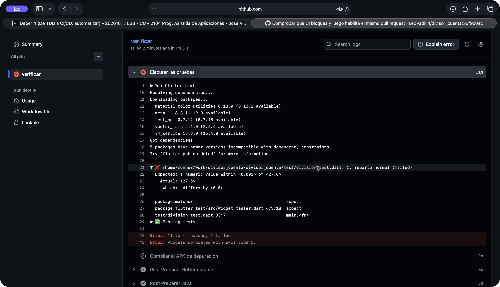
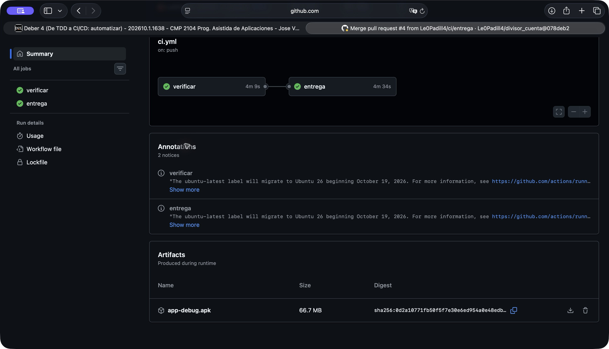
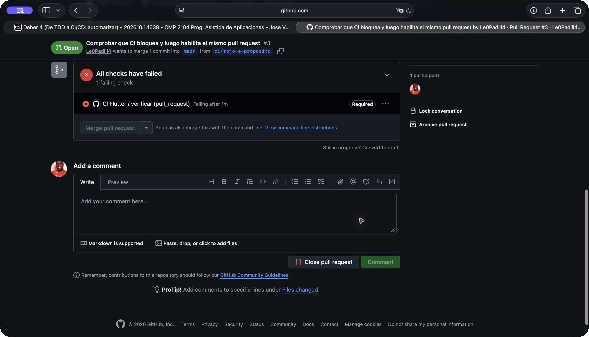

# Respuestas — Deber 4

## 1. ¿Qué hace el workflow?

- **analyze:** revisa el código y señala problemas sin ejecutar la app.
- **test:** comprueba que los casos de prueba sigan pasando.
- **build:** genera el APK de depuración y comprueba que se pueda compilar.

<details>
<summary>Ver ci.yml completo</summary>

```yaml
name: CI Flutter

on:
  push:
    branches: [main]
  pull_request:

permissions:
  contents: read

jobs:
  verificar:
    runs-on: ubuntu-latest
    timeout-minutes: 20
    steps:
      - name: Obtener el proyecto
        uses: actions/checkout@3d3c42e5aac5ba805825da76410c181273ba90b1 # v7.0.1
        with:
          persist-credentials: false
      - name: Preparar Java
        uses: actions/setup-java@b843ebf9b913146b38da2eaa7aeddf76074ae1ad # v6.1.0
        with:
          distribution: temurin
          java-version: '17'
      - name: Preparar Flutter estable
        uses: subosito/flutter-action@1a449444c387b1966244ae4d4f8c696479add0b2 # v2.23.0
        with:
          channel: stable
          flutter-version: '3.47.8'
      - name: Instalar dependencias
        run: flutter pub get
      - name: Analizar el código
        run: flutter analyze
      - name: Ejecutar las pruebas
        run: flutter test
      - name: Compilar el APK de depuración
        run: flutter build apk --debug

  entrega:
    needs: verificar
    if: github.event_name == 'push' && github.ref == 'refs/heads/main'
    runs-on: ubuntu-latest
    timeout-minutes: 20
    steps:
      - name: Obtener el proyecto
        uses: actions/checkout@3d3c42e5aac5ba805825da76410c181273ba90b1 # v7.0.1
        with:
          persist-credentials: false
      - name: Preparar Java
        uses: actions/setup-java@b843ebf9b913146b38da2eaa7aeddf76074ae1ad # v6.1.0
        with:
          distribution: temurin
          java-version: '17'
      - name: Preparar Flutter estable
        uses: subosito/flutter-action@1a449444c387b1966244ae4d4f8c696479add0b2 # v2.23.0
        with:
          channel: stable
          flutter-version: '3.47.8'
      - name: Instalar dependencias
        run: flutter pub get
      - name: Volver a generar el APK en este job
        run: flutter build apk --debug
      - name: Publicar el APK
        uses: actions/upload-artifact@cf430e030ddbb5b0abf93d22962f4752f3646cd9 # v7.0.2
        with:
          name: app-debug.apk
          path: build/app/outputs/flutter-apk/app-debug.apk
          if-no-files-found: error
```

</details>

[Primer CI en verde](evidencias/parte1_ci_verde.png).

## 2. ¿Qué mostró el fallo?

El log decía `Expected: a numeric value within <0.001> of <27.0>` y `Actual: <27.5>`.
La prueba de reparto normal tenía un resultado esperado incorrecto. El fallo aparece
en `test/division_test.dart:33:7`.



## 3. ¿Qué diferencia hay entre CI, delivery y deployment?

CI revisa automáticamente cada cambio. Delivery prepara un entregable y deja la
publicación para una decisión posterior. Deployment lo publica automáticamente.
Aquí se implementaron CI y una entrega de APK de depuración, porque el deber pide
preparar el archivo, sin desplegarlo a producción.



## 4. ¿Qué evita la protección de main?

Evita unir un cambio mientras falle una comprobación obligatoria. En el PR de prueba,
el botón de merge quedó bloqueado hasta restaurar el resultado correcto y pasar CI.



[Protección guardada](evidencias/parte2_proteccion.png) ·
[Rama main y PR obligatorio](evidencias/parte2_rama_main.png) ·
[Protección también para administradores](evidencias/parte2_sin_bypass.png) ·
[El mismo PR vuelve a verde](evidencias/parte3_verde_otra_vez.png).

## 5. ¿Qué acepté de la revisión del agente?

El agente señaló que usar «stable» sin fijar una versión podía cambiar el entorno.
Acepté fijar Flutter 3.47.8 y descarté usar automáticamente cada nueva versión
estable, para que las compilaciones del deber usen la misma versión.

## 6. ¿Qué garantiza un CI verde?

Que ese cambio pasó el análisis, las pruebas definidas y la compilación. Pueden
quedar errores que ninguna prueba revise. Por ejemplo, un texto difícil de leer
en un celular pequeño podría pasar en verde.

## 7. ¿Qué detectó el pipeline que no había visto?

El fallo de este ejercicio fue intencional: se puso 27.00 donde correspondía 27.50.
El pipeline detectó la diferencia y bloqueó el PR. No apareció otro fallo inesperado
en las comprobaciones realizadas.
